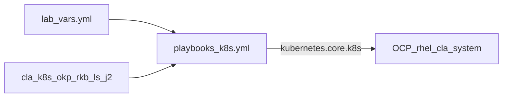

# RHEL CLA on OpenShift — Ansible k8s path

OpenShift deploy for the CLA stack (**OKP + RHEL Knowledge Bridge + Lightspeed**)
reuses the collection’s Kubernetes templates and playbook. Lab Granite stays
out of cluster (**option B**: `http://10.20.1.200:8000/v1`).

Branch: `dasm-ocp-deployment`  
Cluster: `2026-prod-1`  
Namespace: `rhel-cla-system` (see [`lab-vars.yml`](lab-vars.yml))

---

## Source of truth

| Piece | Location |
| --- | --- |
| Playbook | [`collections/.../playbooks/k8s.yml`](../collections/ansible_collections/rhel/cla/playbooks/k8s.yml) |
| Shared NS / NetPol / Quota / Granite Job | role `rhel.cla.cla_k8s` → `templates/k8s/` |
| OKP / RKB / Lightspeed | roles `okp`, `rhel_knowledge_bridge`, `lightspeed_stack` → `tasks/k8s.yml` + `templates/k8s/*.j2` |
| Lab values (digests, PVC, ramalama URL) | [`lab-vars.yml`](lab-vars.yml) |
| Secrets | [`scripts/seed-secrets-from-rhel.sh`](scripts/seed-secrets-from-rhel.sh) (never committed) |

Do **not** hand-maintain parallel Deployment/Service YAML under this directory.
Change behavior in the role Jinja templates so Quadlet-adjacent and cluster
paths stay aligned.



### Feature flags (defaults in `cla_k8s` / role defaults)

| Variable | Lab (`lab-vars.yml`) | Purpose |
| --- | --- | --- |
| `cla_create_namespace` | `true` | Create project/namespace |
| `cla_network_policies` | `true` | Default-deny + DNS / in-NS / router / Granite egress / probes |
| `cla_resource_quota` | `true` | ResourceQuota + LimitRange |
| `okp_use_pvc` | `true` | OKP Solr data on PVC (else emptyDir) |
| `ls_create_route` | `true` | OpenShift Route for Lightspeed |
| `cla_granite_connectivity_job` | `true` | One-shot Job + egress policy to lab Granite |
| `cla_pull_secret_name` | `redhat-pull-secret` | Wire `imagePullSecrets` on workload SAs |
| `*_container_image_digest` | set | Pin images by digest when non-empty |

---

## Lab apply

Prerequisites: `oc` logged into the cluster, `ansible-playbook`, collection
`kubernetes.core`, and network reachability from cluster nodes to
`10.20.1.200:8000`.

```bash
# 0) Optional: dump manifests (gitignored generated/) and/or dry-run
make -C openshift-deployment render
make -C openshift-deployment check

# 1) Secrets (pull + OKP access key) from the RHEL Quadlet host
RHEL_PASS=… make -C openshift-deployment seed

# 2) Apply via Ansible k8s roles
make -C openshift-deployment apply

# 3) Verify
make -C openshift-deployment verify
make -C openshift-deployment granite-check   # optional Job re-run
```

Equivalent playbook invocation:

```bash
cd /path/to/rhel-cla-installer
ansible-playbook -i localhost, -c local \
  collections/ansible_collections/rhel/cla/playbooks/k8s.yml \
  -e @openshift-deployment/lab-vars.yml
```

### OKP on OpenShift (encoded in `okp` k8s templates)

| Requirement | Manifest behavior |
| --- | --- |
| Single pod / RWO | `strategy: Recreate` |
| Long first boot | `startupProbe` ~45m; `progressDeadlineSeconds: 3600` |
| Restricted SCC unpack | ConfigMap `*-tar-wrapper` mounted at `/usr/local/bin/tar` + PATH including `/usr/sbin` |
| Durable index | PVC when `okp_use_pvc: true` |

---

## Layout (this directory)

```
openshift-deployment/
  OC-Deployment.md          # this file
  lab-vars.yml              # OCP lab extras for the playbook
  Makefile                  # seed / apply / verify / granite-check
  examples/
    command-line-assistant.config.toml.example
  scripts/
    seed-secrets-from-rhel.sh
    apply.sh                # wraps ansible-playbook k8s.yml
    verify.sh
    expose-lab-granite.sh
```

---

## What we are not doing here

- Not modifying the local Granite Quadlet docs (PR #61).
- Not installing RHOAI / in-cluster model serving yet (change
  `ramalama_config.base_url` in `lab-vars.yml` when ready).
- Not committing secrets or registry `auth.json`.

---

## Troubleshooting

| Symptom | Likely cause | What to do |
| --- | --- | --- |
| `ErrImagePull` | Missing `redhat-pull-secret` | Re-run `seed` |
| OKP `ERR_013` / tar mode errors | Tar-wrapper CM not applied | Ensure OKP k8s tasks ran; bump `configmap-hash` in `okp-deployment.j2` after wrapper edits |
| Two OKP pods / volume attach errors | RollingUpdate | Templates must use `Recreate` |
| Lightspeed up, chat fails | Cluster cannot reach Granite | `make granite-check`; firewalld on `10.20.1.200` |
| goose / empty model 404 | Wrong `default_model` | Use provider id without `ramalama/` prefix (see `lab-vars.yml`) |
