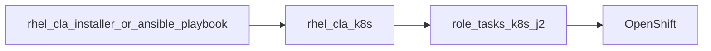

# RHEL CLA on OpenShift — Ansible notes

OpenShift deploy uses the **same collection interface** as local install:
Jinja templates in each role’s `templates/k8s/`, applied by the
`rhel.cla.k8s` playbook. Do not maintain a parallel static manifest tree.

```bash
# Preferred (self-contained installer)
./rhel-cla-installer rhel.cla.k8s -e @examples/openshift-lab-vars.yml

# Equivalent
ansible-playbook -i localhost, -c local \
  collections/ansible_collections/rhel/cla/playbooks/k8s.yml \
  -e @examples/openshift-lab-vars.yml
```

Preview: add `--check --diff`. Remove: `rhel.cla.k8s_uninstall` with the same
vars file.

See [`collections/ansible_collections/rhel/cla/README.md`](../collections/ansible_collections/rhel/cla/README.md)
for variable flags (`cla_namespace`, `okp_use_pvc`, `rhel_cla_provider`, …).



## Lab profile (optional)

[`examples/openshift-lab-vars.yml`](../examples/openshift-lab-vars.yml) pins
digests and points Lightspeed at external lab Granite
(`http://10.20.1.200:8000/v1`). Adjust for your cluster / provider.

**Prerequisites (not done by the playbook):**

1. `oc` logged into the cluster; `kubernetes.core` available to Ansible
2. Namespace pull secret + OKP access key Secret present

Optional lab-only helpers in this directory (convenience — **not** the install
interface):

| Helper | Purpose |
| --- | --- |
| [`scripts/seed-secrets-from-rhel.sh`](scripts/seed-secrets-from-rhel.sh) | Copy registry auth + OKP key from a Quadlet host into the namespace |
| [`scripts/verify.sh`](scripts/verify.sh) | Quick `oc` / curl checks after apply |
| [`scripts/expose-lab-granite.sh`](scripts/expose-lab-granite.sh) | Lab firewall / PublishPort for host Granite |
| [`examples/command-line-assistant.config.toml.example`](examples/command-line-assistant.config.toml.example) | Point `c` / clad at the Lightspeed Route |

## OKP on OpenShift (in role templates)

| Requirement | Behavior in `okp` k8s templates |
| --- | --- |
| Single pod / RWO | `strategy: Recreate` |
| Long first boot | Long `startupProbe`; `progressDeadlineSeconds: 3600` |
| Restricted SCC unpack | Tar-wrapper ConfigMap + PATH |
| Durable index | PVC when `okp_use_pvc: true` |

## Troubleshooting

| Symptom | Likely cause | What to do |
| --- | --- | --- |
| `ErrImagePull` | Missing pull secret | Seed or create `redhat-pull-secret`; set `cla_pull_secret_name` |
| DNS / MCP timeouts in-cluster | NetworkPolicy blocking DNS | Ensure `cla_network_policies` templates include DNS egress |
| Route chat 504 ~300s | Edge proxy idle timeout | Use port-forward for long lab CPU replies, or raise edge timeout |
| Granite unreachable | Host firewall on `:8000` | Open port or run `expose-lab-granite.sh` |
