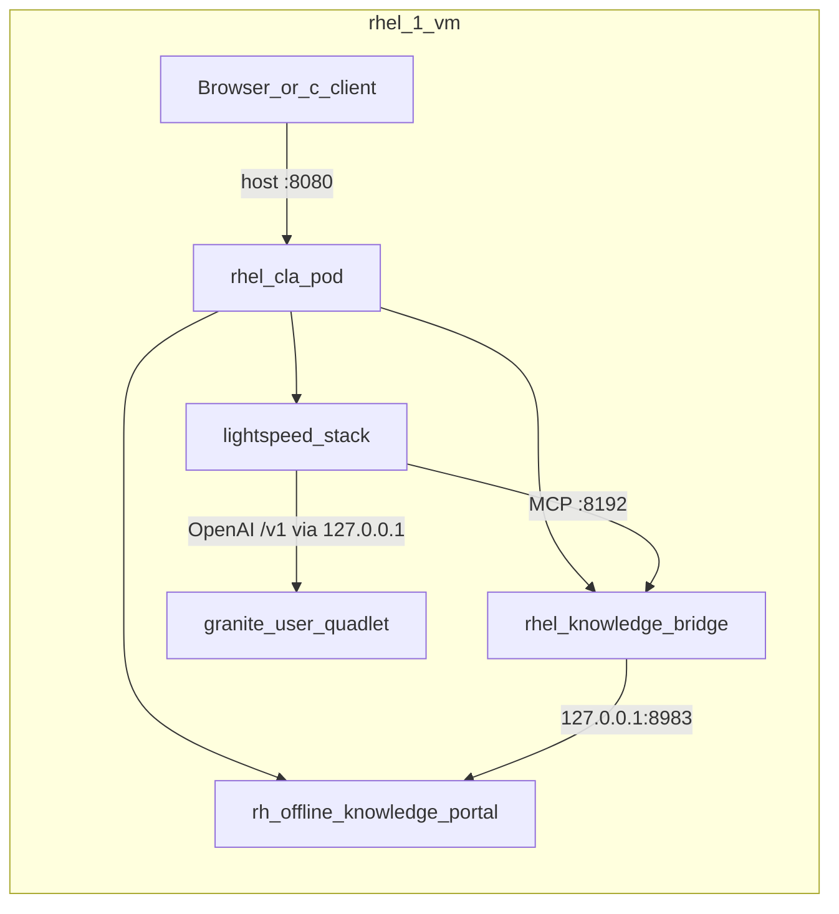
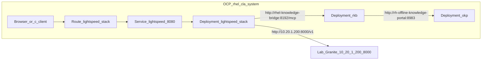

# RHEL CLA on OpenShift — deployment plan and manifests

This directory is a **manifest-first** OpenShift port of the live Podman/Quadlet
CLA stack running on the lab RHEL host (`10.20.1.200`). It intentionally leaves
the existing Quadlet installer path alone.

Branch: `dasm-ocp-deployment`  
Cluster: `2026-prod-1` (`api.2026-prod-1.ocp.dasmlab.org`)  
Namespace: `rhel-cla-system`

---

## Build plan and choices

| Choice | Decision | Why |
| --- | --- | --- |
| Scope | Deploy **OKP + RHEL Knowledge Bridge + Lightspeed Stack** only | Matches the `rhel-cla` Podman pod on the lab host; Granite stays out of cluster for this MVP |
| Granite / LLM | **Option B** — call lab Granite at `http://10.20.1.200:8000/v1` | Same inventory/`ramalama_config` semantics as today; RHOAI cutover later by changing `base_url` |
| Images / tags | Exact tags from the live Quadlet `.image` units | Bit-for-bit parity with what already works on `rhel-1-vm` |
| Config source | `/var/lib/containers/lightspeed-stack/*` + `inventory/hosts.yml` on the RHEL host | Avoid inventing new provider wiring; port what Ansible already rendered |
| Secrets | Created at apply time from host `auth.json` + `okp_access_key` | Never commit OKP key or registry credentials |
| Packaging | Static YAML + Kustomize (not Ansible k8s role) | Existing `roles/*/templates/k8s/*.j2` are WIP (e.g. `okp_part` typo, Vertex-centric LS); clean manifests are clearer for review |
| Network note | Lab Granite must be reachable at `10.20.1.200:8000` from cluster nodes | Live host already publishes `0.0.0.0:8000`; ensure firewalld allows it if pods cannot connect |
| Ports | Lightspeed Service `:8080` → container `:8081`; OKP Solr `:8983`; RKB MCP `:8192` | Mirrors Quadlet `PublishPort=8080:8081` and in-pod localhost URLs rewritten to Services |

### What we are **not** doing in this pass

- Not modifying `docs/setup-granite-quadlet.sh` or the Local Installation README work on PR #61.
- Not installing RHOAI / in-cluster model serving yet.
- Not committing secrets or copying `/etc/containers/auth.json` into git.

### Follow-up (RHOAI)

When RHOAI exposes an OpenAI-compatible endpoint in-cluster:

1. Update [`base/config/llama-stack.yml`](base/config/llama-stack.yml) `providers.inference[0].config.base_url`.
2. Align `models[].provider_model_id` / `default_model` with the served model id.
3. Drop the lab Granite dependency and the `expose-lab-granite.sh` step.

---

## Before / after layout

### Before — Podman Quadlets on RHEL (`10.20.1.200`)



Live units (reference):

- System Quadlets under `/etc/containers/systemd/`: `rhel-cla.pod`, `rh-offline-knowledge-portal.*`, `rhel-knowledge-bridge.*`, `lightspeed-stack.*`
- User Quadlet `~/.config/containers/systemd/granite.container` (LLM only)
- Config: `/var/lib/containers/lightspeed-stack/{lightspeed-stack.yml,llama-stack.yml,system_prompt.txt}`
- Inventory: `/home/dasm/rhel-cla-installer/inventory/hosts.yml` (`rhel_cla_provider: ramalama`, OKP key, model id)

### After — OpenShift (`rhel-cla-system`)



---

## Images (pinned to lab host)

| Component | Image |
| --- | --- |
| OKP | `registry.redhat.io/offline-knowledge-portal/rhokp-rhel9:1.2.9-1784730494` |
| Knowledge bridge | `registry.redhat.io/rhel-cla/rhel-knowledge-bridge-rhel10:v1.0.2-1785450151` |
| Lightspeed stack | `registry.redhat.io/lightspeed-core/lightspeed-stack-rhel9:0.6.4` |

---

## Directory layout

```text
openshift-deployment/
  OC-Deployment.md                 # this file — plan, choices, diagrams
  base/                            # Namespace, Deployments, Services, Route, SAs
    config/                        # Lightspeed config ported from the RHEL host
      lightspeed-stack.yml
      llama-stack.yml              # base_url -> http://10.20.1.200:8000/v1
      system_prompt.txt
  overlays/lab/                    # Lab overlay (kustomize entrypoint)
  scripts/
    seed-secrets-from-rhel.sh      # pull-secret + okp-access-key from RHEL host
    expose-lab-granite.sh          # PublishPort 0.0.0.0:8000 for option B
    apply.sh                       # oc apply -k + wait
```

---

## Apply (lab)

Prereqs: `oc` logged into `2026-prod-1` as a user that can create projects/secrets/deployments/routes.

```bash
# 0) Lab Granite must already listen on 0.0.0.0:8000 (current rhel-1-vm state).
#    Only if it is bound to 127.0.0.1 again:
#    RHEL_PASS=... ./openshift-deployment/scripts/expose-lab-granite.sh

# 1) Seed secrets from the RHEL host inventory + auth.json
RHEL_PASS=... ./openshift-deployment/scripts/seed-secrets-from-rhel.sh

# 2) Apply manifests (OKP image pull can take 10–30+ minutes)
./openshift-deployment/scripts/apply.sh
```

Verify:

```bash
oc -n rhel-cla-system get pods,svc,route
HOST=$(oc -n rhel-cla-system get route lightspeed-stack -o jsonpath='{.spec.host}')
curl -sk "https://${HOST}/api/lightspeed/liveness"
```

Point `command-line-assistant` `endpoint` at `https://<route>/v1` (or http if testing insecure) the same way the README describes for local `:8080`.

---

## Teardown

```bash
oc delete project rhel-cla-system
# optional: restore Granite PublishPort=127.0.0.1:8000:8000 on the RHEL host
```
